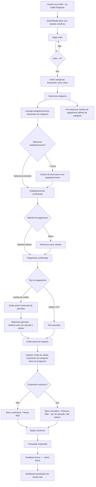
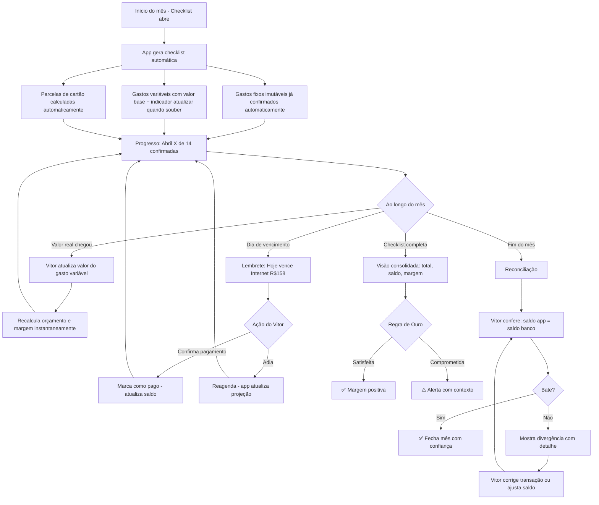
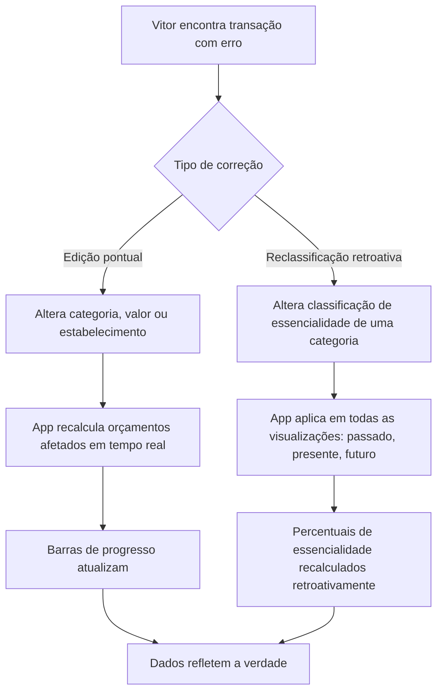
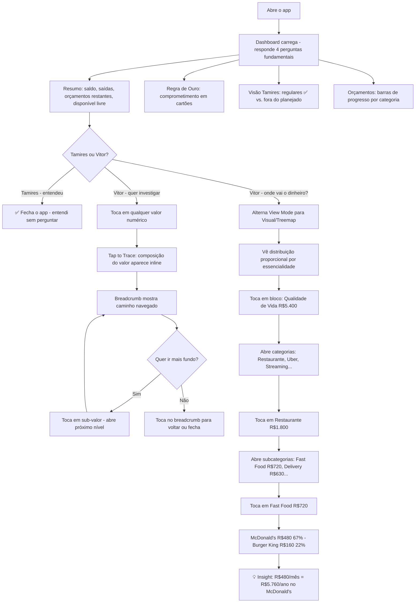
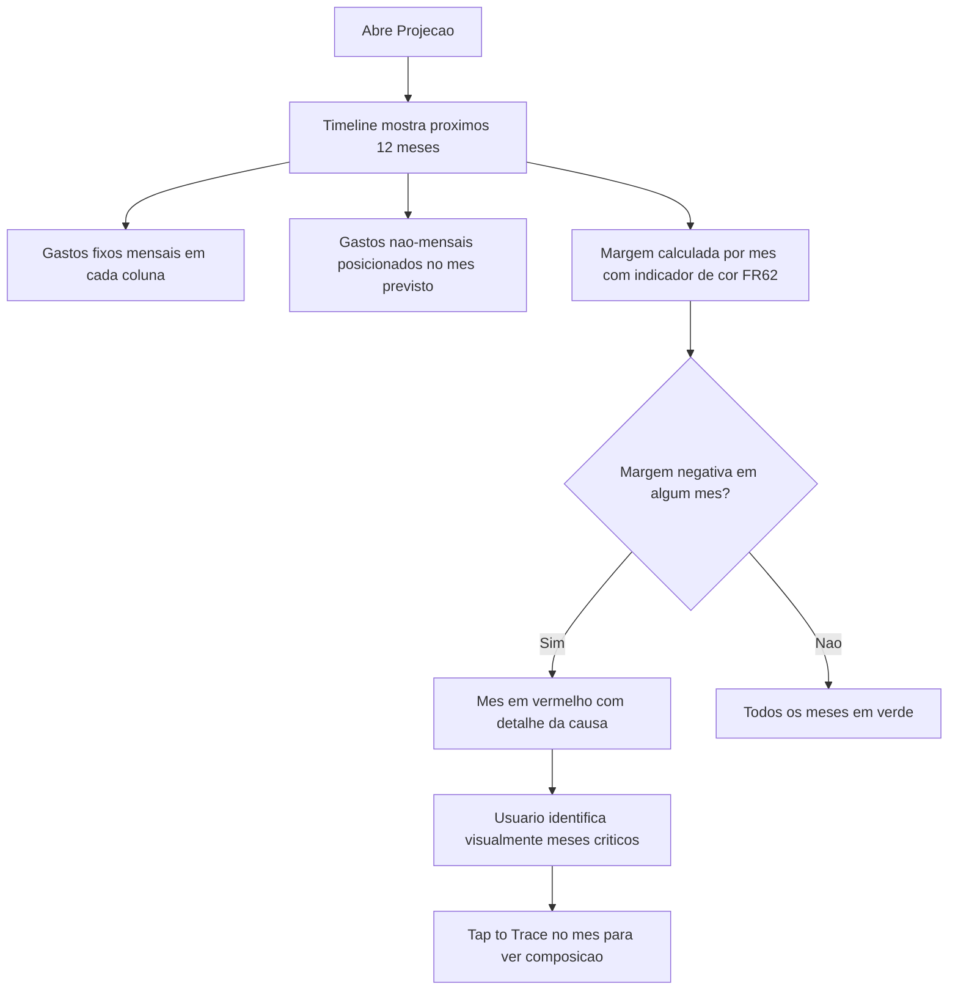
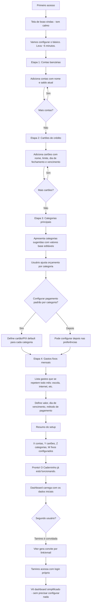

# UX Design Specification Caderninho

**Author:** Vitorcastilho
**Date:** 2026-03-10

---

## Executive Summary

### Visao do Projeto

O Caderninho e uma web app responsiva (SPA) de gestao financeira pessoal e familiar que transforma o esforco disciplinado de registro — que ja existe — em compreensao visual compartilhada e projecao de futuro. Substitui uma planilha Excel sofisticada mas incompreensivel para terceiros, operando em tres dimensoes temporais: ontem (como estavamos), hoje (como estamos) e amanha (para onde vamos se continuarmos assim).

O produto e de uso pessoal/familiar — nao comercial. Isso libera o design de convencoes de mercado e permite focar 100% em resolver o problema real de dois usuarios especificos.

### Usuarios-Alvo

**Vitor — Gestor Financeiro (Power User)**
Programador, 42 anos, responsavel por 100% da gestao financeira familiar. Gerencia multiplas entidades (contas pessoais, 4 cartoes de credito, 2 empresas PJ). Registra cada transacao com disciplina — o habito ja existe, a ferramenta que falha. Usa desktop para gestao mensal e celular para registro rapido no momento do gasto. Precisa de controle analitico completo, drill-down, projecao futura e transparencia total nos calculos. Seu momento "valeu a pena": quando o app devolve insights que a planilha nunca conseguiu, e a Tamires para de precisar dele como intermediario das financas.

**Tamires — Decisora Eventual (Consumidora Visual)**
Psicologa, 38 anos, empresa propria com receita variavel. Nao quer (nem precisa) acompanhar cada detalhe — quer respostas visuais instantaneas. Interage com financas quando surge um evento (viagem, compra grande, planejamento). Controla suas financas pessoais pelo saldo da conta. Usa exclusivamente celular para consultas pontuais. Seu momento "valeu a pena": quando ve gastos de R$22.000 no cartao e entende em 5 segundos que R$10.400 foram decisoes especificas e os gastos regulares estao dentro do combinado — sem perguntar ao Vitor.

### Desafios-Chave de Design

1. **Dois perfis, uma interface**: Servir um power user que precisa de cockpit analitico completo e uma consumidora eventual que precisa de respostas visuais instantaneas — sem que a complexidade de um assuste o outro
2. **Registro rapido com profundidade**: Fluxo cascata de ~5 segundos no celular que carrega muita informacao (categoria, estabelecimento, cartao, parcelas, feedback de impacto) — equilibrio entre velocidade e completude
3. **Complexidade financeira invisivel**: Orcamento em 3 camadas, multiplas entidades, tipos de recorrencia, fluxo empresa→pessoal — sofisticacao no motor sem vazar para a interface
4. **Responsividade contextual**: Desktop e mobile sao contextos de uso diferentes, nao apenas tamanhos — a experiencia precisa ser adaptada ao contexto (gestao vs. registro vs. consulta)

### Oportunidades de Design

1. **Dashboard orientado por perguntas**: Respostas a perguntas reais ("Quanto posso gastar?", "A gente pode?") em vez de graficos genericos — diferencial competitivo e identidade do produto
2. **Feedback instantaneo como recompensa**: Cada registro devolve insight visivel, transformando registro de gasto em momento de consciencia financeira — loop de engajamento natural
3. **Linguagem visual como tradutor financeiro**: Barras de progresso, semaforos, indicadores de status que eliminam a barreira de comunicacao financeira entre o gestor e a decisora
4. **Transparencia como confianca**: Tap to trace — tocar em qualquer numero e ver sua composicao — construindo confianca absoluta nos dados, pre-requisito para aposentar a planilha

## Core User Experience

### Experiencia Definidora

O Caderninho tem duas interacoes igualmente criticas que se alimentam mutuamente:

**1. Registrar e rapido (Input)** — O fluxo cascata progressiva de ~5 segundos (podendo chegar a ~3 segundos em categorias com pagamento padrao configurado) e o motor do sistema. Valor → Categoria → Estabelecimento → Pagamento → Parcelas. A tela se revela conforme contexto — nao e wizard multi-tela nem tela sobrecarregada. E uma tela que cresce. Teclado numerico abre direto. Cada selecao reduz as opcoes seguintes e pre-preenche inteligentemente (categoria "Gasolina" ja traz cartao PDA a vista como default configurado pelo usuario). Feedback de impacto antes de confirmar.

**2. Entender e instantaneo (Output)** — O dashboard que responde perguntas reais e o retorno do esforco. Nao e um painel de graficos — e um tradutor financeiro. "Quanto posso gastar em comida?" tem resposta visual direta. "A gente pode viajar?" tem resposta visual direta com dados concretos de onde economizar. Cada numero e tocavel e rastreavel a origem.

**O loop fundamental:** Registrar → Ver impacto → Entender situacao → Tomar decisao → Registrar. A disciplina que ja existe e finalmente recompensada.

### Estrategia de Plataforma

**Web App Responsiva (SPA)** com tres contextos de uso distintos:

| Contexto | Dispositivo | Usuario | Foco | Cenario |
|---|---|---|---|---|
| **Registro rapido** | Celular | Vitor (principalmente) | Input — registrar gasto no momento | No estacionamento do supermercado, ~3-5 segundos |
| **Gestao e analise** | Desktop | Vitor | Controle — reconciliacao, checklist, drill-down, projecao | Computador + celular com apps bancarios abertos lado a lado |
| **Consulta e decisao** | Celular | Tamires | Output — respostas visuais, status financeiro | Na sala, antes de decidir sobre uma viagem |

**Implicacoes de design:**
- **Mobile**: prioriza registro rapido (Vitor) e dashboard visual (Tamires). Touch-first. Telas verticais otimizadas para polegar
- **Desktop**: prioriza gestao mensal, reconciliacao e analise. Layout wide que aproveita espaco horizontal — projetado para quem esta com apps bancarios abertos no celular ao lado. Sem necessidade de alternar abas
- **PWA**: "Adicionar a tela inicial" no celular para acesso instantaneo sem app store
- **Real-time**: mudancas propagadas entre dispositivos e usuarios sem recarregar — Vitor registra no celular, dashboard atualiza no desktop

### Interacoes Sem Esforco

**Zero navegacao para o essencial:**
- Abrir o app → dashboard ja responde as 4 perguntas fundamentais (contas a pagar, orcamento comida, orcamento gasolina, margem livre)
- Registrar gasto → uma tela, tudo visivel, sem "proximo", sem abas, sem carregamento
- Ver impacto → feedback antes de confirmar, sem precisar navegar para outro lugar

**Inteligencia que elimina digitacao:**
- Categoria sugere estabelecimentos frequentes (top 5 dos ultimos 90 dias)
- Categoria carrega regras de negocio (orcamento vinculado, subcategorias)
- **Metodo de pagamento padrao por categoria**: o usuario configura a forma de pagamento preferida para cada categoria (ex: Gasolina → Cartao PDA a vista, Supermercado → Latam Pass a vista, Escola → Latam Pass a vista, compras online → Cartao X parcelado). Ao selecionar a categoria, o metodo de pagamento vem pre-selecionado — o usuario so confirma ou altera quando for excecao. Isso reduz toques e elimina decisao repetitiva
- Recorrentes auto-preenchidos no inicio do mes — so confirmar ou atualizar
- Parcelas so aparecem quando o metodo de pagamento selecionado e cartao de credito

**Complexidade sob demanda:**
- Superficie simples, profundidade disponivel. Dashboard mostra resumo → toque revela composicao → toque revela transacoes individuais
- Vitor acessa profundidade quando quer. Tamires nunca precisa passar da superficie
- Checklist mensal: fixos ja confirmados, variaveis sinalizados — o minimo de trabalho manual

### Momentos Criticos de Sucesso

**Momento 1 — "3 segundos, feito"** (Registro rapido com defaults)
Vitor abastece e paga. Abre o app, digita 180, toca Gasolina — cartao PDA a vista ja vem selecionado, posto frequente ja aparece sugerido. Toca confirmar. Ve "Orcamento Gasolina: R$420/R$600 — resta R$180". Se esse fluxo travar, tiver loading, ou exigir decisoes que ja foram configuradas, o app falhou.

**Momento 2 — "Entendi sem perguntar"** (Dashboard da Tamires)
Mes com cartao em R$22.000. Tamires abre, ve "Gastos regulares ✅ dentro do planejado | Fora do planejado: Viagem R$9.000 + Motor R$1.400". Se ela precisar perguntar ao Vitor o que aconteceu, o app falhou.

**Momento 3 — "Os numeros batem"** (Confianca nos dados)
Fim do mes. Vitor confere: saldo no app = saldo no banco. Fatura no app = fatura no cartao. Se houver divergencia de R$0,01, a confianca se quebra e a planilha nao aposenta.

**Momento 4 — "Nunca soube disso"** (Insight novo)
Vitor faz drill-down e descobre que gasta R$480/mes no McDonald's — R$6.000/ano. Na planilha, esse dado estava escondido dentro de formulas. Se o app nao revelar informacoes que a planilha escondia, nao superou a planilha.

**Momento 5 — "Da pra ir, e sei de onde cortar"** (Projecao com origem concreta)
Tamires quer saber se a viagem de R$3.500 em junho e viavel. A projecao nao diz apenas "economize R$500/mes" — mostra de onde: "Gastos nao essenciais atuais: R$5.400/mes — Restaurante R$1.800 (33%), Uber R$900 (17%), Compras pessoais R$1.500 (28%)...". Tamires ve que reduzir restaurante e delivery em 30% ja cobre R$540/mes. A decisao e informada por dados reais, nao por conselho abstrato. Se a projecao nao mostrar a origem concreta da economia possivel, e so um numero bonito sem acao.

### Principios de Experiencia

1. **Registrar recompensa, nao castiga** — Cada interacao de input devolve insight de output. O esforco de ~3-5 segundos retorna compreensao imediata. Nenhum campo existe sem gerar valor visivel
2. **Responde perguntas, nao exibe dados** — A interface fala a lingua de quem usa. Para o Vitor: "R$480/mes no McDonald's, 67% do fast food". Para a Tamires: "Gastos regulares ✅, fora do planejado: viagem + carro". Projecoes mostram de onde economizar, nao apenas quanto
3. **Superficie simples, profundidade disponivel** — O primeiro nivel e claro para qualquer um. O segundo nivel e util para quem quer entender. O terceiro nivel e completo para quem precisa controlar. Ninguem e forcado a ir mais fundo do que precisa
4. **Cada numero conta sua historia** — Tocar em qualquer valor revela de onde veio. Transparencia total e o antidoto contra ansiedade financeira e o pre-requisito para aposentar a planilha
5. **O contexto adapta a interface** — Celular no supermercado = registro rapido. Desktop no sabado = gestao mensal. Celular no sofa = dashboard de decisao. A mesma plataforma, tres experiencias diferentes guiadas pelo contexto de uso
6. **Configurar uma vez, usar sempre** — Metodo de pagamento padrao por categoria, estabelecimentos frequentes, recorrentes auto-preenchidos. O app aprende os padroes do usuario e elimina decisoes repetitivas — o usuario so intervem nas excecoes

## Desired Emotional Response

### Objetivos Emocionais Primarios

O Caderninho opera numa transformacao emocional especifica para cada perfil:

**Vitor — De frustacao para controle recompensado**

| De (hoje) | Para (com Caderninho) |
|---|---|
| Frustacao — esforco sem retorno | Recompensa — cada registro devolve insight |
| Solidao financeira — luta sozinho | Parceria — Tamires entende sem intermediacao |
| Ansiedade de fim de mes — vai bater? | Confianca — sei que bate porque acompanho em tempo real |
| Cansaco — ritual repetitivo app por app | Fluidez — registro em 3 segundos, reconciliacao guiada |
| Cegueira analitica — dados mortos em formulas | Descoberta — "nunca soube que gastava isso aqui" |

**Tamires — De medo para clareza autonoma**

| De (hoje) | Para (com Caderninho) |
|---|---|
| Medo — R$22.000 no cartao sem contexto | Clareza — entendo em 5 segundos o que aconteceu |
| Dependencia — preciso perguntar ao Vitor | Autonomia — encontro a resposta sozinha |
| Distancia — financas sao "coisa do Vitor" | Participacao — vejo, entendo, sugiro |
| Culpa potencial — "gastamos demais?" | Compreensao — sei o que foi planejado vs. imprevisto |

**A emocao-chave do produto: transformar medo em clareza.** Quando um numero assusta, o Caderninho responde com contexto, nao com mais numeros.

### Mapeamento da Jornada Emocional

**Primeiro contato (onboarding):**
- Sentir: "Isso e simples" — nao sobrecarregar com configuracao. Setup guiado, progressivo, com sensacao de progresso
- Evitar: "Isso vai dar trabalho" — nao pedir tudo de uma vez

**Registro diario (uso frequente):**
- Sentir: "Pronto, feito" — velocidade gera satisfacao. O registro e tao rapido que nao pesa
- Sentir: "Interessante..." — o feedback de impacto pos-registro e um micro-momento de consciencia
- Evitar: "De novo isso..." — nenhuma friccao repetitiva, defaults inteligentes eliminam decisoes ja tomadas

**Dashboard (consulta):**
- Sentir: "Estamos bem" (quando esta) — tranquilidade visual, cores calmas, indicadores positivos discretos
- Sentir: "Entendi o que aconteceu" (quando nao esta) — contexto imediato, sem panico, com explicacao
- Evitar: "O que significa isso?" — nenhum numero sem contexto, nenhum grafico sem resposta

**Fim de mes (reconciliacao):**
- Sentir: "Confiro rapido e fecho" — processo guiado, checklist clara, sem surpresas
- Sentir: "Os numeros batem" — a confianca se constroi mes a mes
- Evitar: "Nao bate e nao sei por que" — divergencias explicadas, rastreabilidade total

**Descoberta de insight (drill-down):**
- Sentir: "Nunca soube disso!" — o momento de maior valor emocional do produto
- Sentir: "Agora sei onde cortar" — poder de decisao informada
- Evitar: "E dai?" — todo insight deve conectar a uma acao possivel

**Retorno ao app (reengajamento):**
- Sentir: "Quero ver como esta" — curiosidade natural, nao obrigacao
- Evitar: "Preciso atualizar..." — o app nao deve gerar divida emocional por falta de atualizacao

### Micro-Emocoes

**Criticas para o sucesso:**

| Micro-emocao | Contexto | Importancia |
|---|---|---|
| **Confianca** vs. Desconfianca | Dados financeiros precisam ser 100% precisos | Sem confianca, a planilha nao aposenta |
| **Clareza** vs. Confusao | Cada tela, cada numero, cada indicador | Confusao gera ansiedade — o oposto do objetivo |
| **Realizacao** vs. Frustacao | Apos registro, apos fechar o mes, apos insight | O esforco precisa ser recompensado |
| **Tranquilidade** vs. Panico | Dashboard com gastos altos ou orcamento estourado | Contexto transforma panico em compreensao |
| **Autonomia** vs. Dependencia | Tamires consultando sem o Vitor | Marca o sucesso do produto como tradutor financeiro |
| **Curiosidade** vs. Indiferenca | Drill-down, projecoes, insights | O app deve provocar "quero ver mais" |

### Implicacoes de Design

**Comunicacao de problemas — calma proporcional a gravidade:**

| Gravidade | Exemplo | Tom Visual | Comportamento |
|---|---|---|---|
| **Informativo** | Categoria chegou a 80% do orcamento | Indicador sutil, cor neutra | Visivel mas nao intrusivo — o usuario nota quando olha |
| **Atencao** | Categoria estourou o orcamento | Indicador visivel, cor de atencao | Destaque na barra de progresso, sem interromper fluxo |
| **Alerta** | Regra de Ouro comprometida (cartoes > saldo) | Indicador claro, cor de alerta | Visivel no dashboard principal, com contexto do que causou |
| **Critico** | Mes projetado para fechar negativo | Indicador proeminente, cor critica | Explicacao completa: o que causou, quanto falta, opcoes |

**Principio: nunca alarme sem contexto.** Todo alerta mostra o que causou e o que pode ser feito. A escala de gravidade e visual (cores, peso, posicao) — nao e pop-up, nao e notificacao invasiva. O usuario percebe pela interface, nao por interrupcao.

**Celebracoes — sobrias e significativas:**

| Conquista | Celebracao | Exemplo |
|---|---|---|
| Mes fechou dentro do planejado | Indicador positivo discreto no resumo mensal | ✅ "Marco: dentro do planejado" — cor positiva, sem animacao |
| Reserva cresceu | Saldo atualizado com destaque sutil na variacao | "Reserva: R$12.500 (+R$500 este mes)" — numero do crescimento em destaque discreto |
| Parcela terminou | Notificacao informativa com impacto no orcamento | "Parcela Fotos concluida — R$171/mes liberados a partir de abril" |
| Paridade com planilha atingida | Marco no historico | "3 meses de paridade atingidos" — reconhecimento factual |
| Insight inedito | O proprio dado e a celebracao | O drill-down que revela R$480/mes no McDonald's nao precisa de decoracao — a informacao e a recompensa |

**Principio: a informacao e a celebracao.** Sem confete, sem estrelas, sem animacoes. O reconhecimento e factual, discreto e proporcional. Um ✅ verde. Um numero de crescimento destacado. Uma frase curta. O dado fala por si.

### Principios de Design Emocional

1. **Contexto antes de numero** — Nenhum valor financeiro aparece sozinho. Todo numero vem acompanhado de referencia (orcamento, meta, historico) que da significado. R$22.000 no cartao assusta; "R$12.600 regulares ✅ + R$9.400 decisoes especificas" informa
2. **Calma como estado padrao** — A interface transmite controle e ordem. Cores neutras predominam. Alertas sao proporcionais a gravidade, nunca alarmistas. O app e um aliado calmo, nao um cobrador ansioso
3. **Recompensa silenciosa** — Celebracoes sao factuais e discretas. Um ✅, um numero de crescimento, uma frase curta. A informacao relevante e a propria recompensa — nenhuma decoracao necessaria
4. **Autonomia progressiva** — O app deve tornar o usuario mais capaz a cada interacao. Tamires que comeca consultando o dashboard passa a propor solucoes. Vitor que comeca conferindo a planilha passa a confiar apenas no app. Cada mes de uso aumenta a confianca
5. **Zero divida emocional** — O app nunca faz o usuario sentir culpa por nao ter atualizado, nao ter registrado, ou ter estourado um orcamento. Sem tons passivo-agressivos, sem contadores de "dias sem registrar", sem gamificacao punitiva. O app espera, nao cobra

## UX Pattern Analysis & Inspiration

### Analise de Produtos Inspiradores

**1. Duolingo — Progressive Disclosure com Resposta Rapida**

O Duolingo resolve um problema analogo ao registro de transacoes: transformar uma acao repetitiva (responder exercicios / registrar gastos) em algo rapido e levemente recompensador.

Padroes relevantes:
- **Uma decisao por vez**: cada tela pede UMA resposta. Nao sobrecarrega com opcoes simultaneas
- **Feedback instantaneo**: acertou/errou aparece imediatamente — no Caderninho, o impacto no orcamento aparece antes de confirmar
- **Progressao visivel**: barra de progresso durante a licao — no Caderninho, barra de progresso do orcamento da categoria
- **Velocidade como recompensa**: a rapidez da interacao gera satisfacao por si so — o proprio ato de registrar em 3 segundos e recompensador

Aplicacao no Caderninho: o fluxo cascata de registro deve ter a mesma sensacao de fluidez — uma selecao por vez, feedback instantaneo, confirmacao rapida. Sem tela de loading, sem transicao pesada.

**2. Finviz / Treemaps de Mercado — Visualizacao Proporcional Instantanea**

Treemaps de bolsa (como os do Finviz) comunicam instantaneamente ONDE esta o peso e QUAL a performance — sem ler numeros. O tamanho do bloco mostra proporcao, a cor mostra status.

Padroes relevantes:
- **Proporcao visual**: blocos maiores = mais relevante. Nao precisa ler numeros para entender a distribuicao
- **Cor como status**: verde/vermelho comunica performance sem palavras
- **Hierarquia navegavel**: clicar num setor abre as acoes individuais — drill-down natural
- **Visao panoramica**: centenas de dados num unico olhar

Aplicacao no Caderninho: visualizacao de "para onde vai o dinheiro" como treemap — Tamires ve um mapa de calor dos gastos familiares onde blocos maiores sao categorias que mais consomem e a cor indica dentro/fora do orcamento. Vitor clica num bloco e ve subcategorias, clica de novo e ve estabelecimentos. Tambem aplicavel para a visao por classificacao de essencialidade — proporcao visual de essenciais vs. nao essenciais vs. investimentos.

**3. Paineis de Veiculo — Indicadores de Status e Tendencia**

Paineis automotivos comunicam informacoes criticas de forma que o motorista processa sem pensar: ponteiros, cores, icones. O motorista sabe se esta tudo bem com um olhar periferico.

Padroes relevantes:
- **Indicadores de status binario**: tudo ok (sem indicador) vs. atencao necessaria (luz acende). Silencioso quando esta bem, visivel quando precisa de acao
- **Gauges/medidores**: mostram posicao atual dentro de um range (vazio/cheio, frio/quente). Comunicam "quanto falta" instantaneamente
- **Tendencia sem grafico**: um ponteiro que sobe ou desce comunica tendencia sem precisar de eixo X/Y
- **Hierarquia de urgencia**: luz verde → amarela → vermelha → piscando. Escala de gravidade visual

Aplicacao no Caderninho: a Regra de Ouro (cartoes vs. saldo) como gauge — ponteiro mostrando o nivel de comprometimento. Orcamento por categoria como barras de progresso estilo tanque de combustivel. Status do mes como indicador binario: ✅ quando dentro do planejado, ⚠️ quando precisa de atencao — exatamente como uma luz no painel. Escala de gravidade dos alertas (informativo → atencao → alerta → critico) usando o mesmo principio da hierarquia de luzes do painel.

### Padroes de UX Transferiveis

**Padroes de Interacao:**

| Padrao | Origem | Aplicacao no Caderninho |
|---|---|---|
| Progressive disclosure | Duolingo | Fluxo cascata: cada selecao revela a proxima camada, sem sobrecarregar |
| Feedback instantaneo | Duolingo | Impacto no orcamento/saldo exibido antes de confirmar a transacao |
| Default inteligente | Teclados preditivos | Metodo de pagamento padrao por categoria, estabelecimentos frequentes |
| Tap to reveal | Apps de banking | Tocar em qualquer valor para ver composicao e origem |

**Padroes de Visualizacao:**

| Padrao | Origem | Aplicacao no Caderninho |
|---|---|---|
| Treemap proporcional | Finviz / bolsa | Visualizacao de distribuicao de gastos por categoria e essencialidade |
| Gauge / medidor | Painel de veiculo | Regra de Ouro, comprometimento de orcamento, saldo disponivel |
| Cor como status | Treemap + painel | Verde (dentro), amarelo (atencao), vermelho (estourado) — sem precisar ler |
| Hierarquia de urgencia | Painel de veiculo | Escala de alertas: sutil → visivel → claro → proeminente |

**Padroes de Navegacao:**

| Padrao | Origem | Aplicacao no Caderninho |
|---|---|---|
| Drill-down hierarquico | Treemaps | Essencialidade → Categoria → Subcategoria → Estabelecimento |
| Dashboard como home | Apps de banking | Abrir o app = ver o status financeiro, sem navegacao |
| Bottom navigation | Apps mobile | Acesso rapido: Dashboard / Registrar / Checklist / Mais |

### Anti-Padroes a Evitar

Extraidos da experiencia real do usuario com apps de financas e do brainstorming:

| Anti-Padrao | Por que falha | Principio inverso no Caderninho |
|---|---|---|
| **Registro sem retorno** | Apps pedem tudo e devolvem graficos de pizza genericos | Cada campo gera insight visivel |
| **Espelho retrovisor** | So mostram passado, sem projecao, sem "e se?" | GPS financeiro — tres dimensoes temporais |
| **Dashboard de metricas** | Graficos bonitos que nao respondem perguntas reais | Dashboard orientado por perguntas |
| **Formulario multi-tela** | Wizard com 4-5 etapas para registrar um gasto | Tela unica cascata, zero navegacao |
| **Categorizacao rigida** | Categorias pre-definidas que nao cabem na vida real | Hierarquia editavel, reclassificacao retroativa |
| **Gamificacao punitiva** | Streaks, contadores de dias, tons de cobranca | Zero divida emocional — o app espera, nao cobra |
| **Dados volateis** | Numeros mudam entre telas sem explicar por que | Transparencia total, tap to trace |
| **Un-perfil-fits-all** | Mesma interface para quem controla e quem consulta | Superficie simples, profundidade disponivel |

### Estrategia de Inspiracao de Design

**Adotar:**
- Fluxo de resposta rapida do Duolingo para o registro cascata — uma decisao por vez, feedback instantaneo
- Treemap proporcional para visualizacao de distribuicao de gastos — comunicacao visual instantanea de "para onde vai o dinheiro"
- Hierarquia de urgencia do painel de veiculo para sistema de alertas — calma proporcional a gravidade

**Adaptar:**
- Gauges de painel de veiculo simplificados para barras de progresso — manter o conceito de "quanto falta" sem a complexidade visual de medidores analogicos
- Drill-down de treemap adaptado para a hierarquia de 4 niveis do Caderninho (essencialidade → categoria → subcategoria → estabelecimento)
- Cor como status adaptada para o tom sobrio do Caderninho — sem vermelho gritante, escala de cores suaves que comunicam gravidade sem gerar panico

**Evitar:**
- Qualquer padrao de gamificacao (streaks, pontos, badges, confete) — conflita com o principio de "zero divida emocional" e "recompensa silenciosa"
- Graficos de pizza como visualizacao primaria — nao respondem perguntas, so mostram proporcao sem contexto acionavel
- Onboarding longo com tour guiado — conflita com "isso e simples". Setup progressivo, aprender fazendo
- Notificacoes push agressivas — conflita com "o app espera, nao cobra". Notificacoes apenas in-app, no dia de vencimento de contas

## Design System Foundation

### Escolha do Design System

**Sistema escolhido: shadcn/ui + Tailwind CSS + Radix UI primitives**

Abordagem de design system "themeable" — componentes copiados para o projeto (nao importados como dependencia), totalmente customizaveis, com base solida de acessibilidade e um sistema de utilidades CSS para responsividade.

### Racional da Selecao

| Criterio | Avaliacao |
|---|---|
| **Controle visual** | Total — componentes sao codigo do projeto, nao de uma lib externa. Qualquer aspecto pode ser modificado sem limitacoes |
| **Tom visual** | Sobrio por padrao — visual limpo, neutro, sem opiniao forte. Alinha com o principio "calma como estado padrao" do Caderninho |
| **Dashboard e dados** | Excelente — integra naturalmente com Recharts, Nivo ou D3.js para treemaps, barras de progresso e visualizacoes financeiras |
| **Responsividade** | Nativa — Tailwind facilita breakpoints (mobile < 768px, desktop >= 1024px) com classes utilitarias, sem CSS customizado |
| **Acessibilidade** | Built-in — Radix primitives cuidam de keyboard navigation, ARIA labels e focus management nos componentes base |
| **Manutencao por 1 dev** | Ideal — documentacao excelente, padroes de copia rapida, comunidade ativa, sem dependencia de versoes externas |
| **Curva de aprendizado** | Moderada — Tailwind e amplamente documentado, shadcn/ui tem exemplos prontos para cada componente |

### Abordagem de Implementacao

**Camada 1 — Fundacao (Tailwind CSS)**
- Design tokens definidos via tailwind.config: cores, espacamento, tipografia, bordas, sombras
- Breakpoints: mobile (< 768px) e desktop (>= 1024px) como experiencias igualmente completas
- Tema claro como padrao. Dark mode como possibilidade futura, nao prioridade

**Camada 2 — Componentes Base (shadcn/ui + Radix)**
- Componentes copiados para o projeto: Button, Input, Select, Dialog, Sheet, Tabs, Card, Table, Badge, Toast, Dropdown, Popover, Tooltip
- Cada componente customizado para o tom visual do Caderninho (cores, bordas, espacamento)
- Componentes de formulario otimizados para o fluxo cascata de registro rapido

**Camada 3 — Componentes de Dados e Visualizacao**
- Biblioteca de graficos: Recharts (leve, React-native) ou Nivo (baseado em D3, suporta treemaps)
- Componentes customizados do Caderninho: barras de progresso de orcamento, gauge da Regra de Ouro, indicadores de status (✅/⚠️), treemap de distribuicao de gastos
- Estes componentes sao especificos do dominio — nao vem de nenhuma biblioteca, serao construidos sobre as primitivas

**Camada 4 — Padroes de Composicao**
- Layouts responsivos: dashboard grid para desktop, stack vertical para mobile
- Padroes de navegacao: sidebar colapsavel no desktop, bottom navigation no mobile
- Padroes de interacao: tap to trace (tocar em valores), drill-down hierarquico, fluxo cascata

### Estrategia de Customizacao

**Design Tokens do Caderninho:**

Tokens a definir nos proximos passos (Visual Foundation):
- **Paleta de cores**: cores neutras predominantes, escala de gravidade (informativo → atencao → alerta → critico), cor de sucesso/positivo discreta
- **Tipografia**: fonte legivel, hierarquia clara (numeros financeiros com peso visual, labels secundarios sutis)
- **Espacamento**: generoso no mobile (touch targets >= 44px), eficiente no desktop (densidade de informacao)
- **Bordas e sombras**: sutis — o conteudo e o protagonista, nao o container

**Componentes customizados a criar:**
- `BudgetProgressBar` — barra de progresso de orcamento por categoria com indicador de status
- `GoldenRuleGauge` — indicador visual da Regra de Ouro (cartoes vs. saldo)
- `StatusIndicator` — ✅/⚠️ com escala de gravidade proporcional
- `SpendingTreemap` — mapa de calor de distribuicao de gastos navegavel
- `CascadeInput` — fluxo de registro cascata com progressive disclosure
- `TapToTrace` — componente wrapper que torna qualquer valor tocavel/clicavel para revelar composicao
- `TimelineProjection` — timeline de parcelas e gastos recorrentes nao-mensais
- `PlanningKanban` — timeline de planejamento com drag-and-drop de gastos entre meses
- `MonthChecklist` — checklist mensal com tipos de recorrencia e progresso

## Experiencia Definidora Detalhada

### Definicao

**"Registro em 3 toques, e ja sei quanto posso gastar"** + **"Toquei no numero e entendi de onde veio"** + **"Mudo a visualizacao e vejo o mesmo dado de outro angulo"**

O Caderninho tem tres mecanicas definidoras:
1. **Cascade Input** — registro rapido com progressive disclosure e feedback instantaneo
2. **Tap to Trace** — qualquer numero e tocavel e revela sua composicao e origem
3. **View Modes** — mesmos dados, multiplas visualizacoes alternadas com um toque

### Modelo Mental do Usuario

**Modelo herdado da planilha (Vitor):**
O Vitor pensa em tres camadas temporais: base historica (quanto normalmente custa) → projecao mensal (quanto vai custar este mes) → execucao diaria (quanto falta pagar). Esse modelo e valido e o Caderninho o honra — mas nao o expoe como estrutura rigida. As tres camadas existem no motor de calculo, e o usuario as percebe naturalmente pela interface: o orcamento planejado e a base, o valor atualizado do mes e a projecao, e "o que falta pagar" e a execucao.

**Modelo intuitivo da Tamires:**
Tamires pensa em termos binarios: "estamos bem" ou "nao estamos". Sua entrada no sistema e visual — cores, proporcoes, indicadores de status. Ela nao precisa entender as tres camadas; precisa ver o resultado delas traduzido em linguagem visual.

**Modelo proposto pelo Caderninho:**
O app propoe um modelo mental unificado baseado em **perguntas e respostas visuais com profundidade sob demanda**:
- Superficie: resposta visual direta ("Gastos regulares ✅ dentro do planejado")
- Segundo nivel: composicao ("Supermercado R$2.122/R$3.000, Gasolina R$420/R$600...")
- Terceiro nivel: detalhe ("Supermercado → 80% Pao de Acucar, 12% Extra, 8% outros")
- Quarto nivel: transacoes individuais

Cada usuario navega ate o nivel que precisa. E em cada nivel, pode alternar o **modo de visualizacao**.

### Criterios de Sucesso da Experiencia Core

| Interacao | Criterio | Meta |
|---|---|---|
| Cascade Input | Tempo de registro com defaults configurados | < 5 segundos, meta ~3 segundos |
| Cascade Input | Toques necessarios para gasto com default | 3-4 toques (valor + categoria + confirmar) |
| Cascade Input | Feedback de impacto antes de confirmar | Visivel em < 100ms apos selecao |
| Tap to Trace | Toques ate composicao de qualquer valor | 1 toque = composicao, 2 = detalhe |
| Tap to Trace | Tempo de carregamento da composicao | < 500ms |
| View Modes | Alternancia entre modos | 1 toque, transicao < 300ms |
| View Modes | Consistencia de dados entre modos | 100% — mesmos dados, representacao diferente |
| Dashboard | Tempo para responder "estamos bem?" | < 5 segundos apos abrir o app |

### Padroes de UX — Novel vs. Estabelecido

**Padroes estabelecidos (usuarios ja conhecem):**
- Progressive disclosure (Duolingo, formularios inteligentes) — aplicado no Cascade Input
- Tap to expand/reveal (apps de banking, acordeoes) — aplicado no Tap to Trace
- View mode toggle (Finder, Google Drive, file managers) — aplicado nos View Modes
- Bottom navigation (apps mobile padrao) — navegacao principal no mobile
- Dashboard como home (apps de banking, fitness) — abrir = ver status
- Kanban drag-and-drop (Trello, Jira, boards) — aplicado no planejamento da timeline

**Combinacao inovadora (familiar, mas com twist):**
- **Cascade Input com feedback financeiro**: formularios progressivos existem, mas o feedback de impacto no orcamento/saldo ANTES de confirmar e novo. E o "registro como momento de consciencia" — nenhum app de financas faz isso
- **Tap to Trace com drill-down ilimitado**: apps de banking mostram detalhes de transacao, mas navegar de um totalizador do dashboard ate a transacao individual em 3-4 toques, passando por cada camada de composicao, e novo
- **View Modes financeiros**: file managers fazem isso com arquivos. Aplicar o conceito a dados financeiros (treemap vs. lista vs. timeline para os mesmos dados) e combinacao nova
- **Timeline Kanban financeira**: Kanban e familiar, mas aplicar a metafora para planejar gastos futuros arrastando entre meses com recalculo instantaneo de margens e novo no dominio de financas pessoais

**Nenhum padrao genuinamente novo** — tudo e construido sobre metaforas que o usuario ja conhece. A inovacao esta na combinacao e na aplicacao ao dominio financeiro.

### Mecanica Detalhada — Cascade Input (Registro Rapido)

**1. Iniciacao:**
- Mobile: botao flutuante (FAB) no canto inferior ou acao na bottom navigation
- Desktop: atalho de teclado ou botao visivel no header
- A tela de registro abre como sheet (mobile) ou modal (desktop) — nao navega para outra pagina

**2. Interacao passo a passo:**

```
[Tela inicial — teclado numerico aberto]
┌─────────────────────────────┐
│  R$ ____                    │  ← Cursor ativo, teclado numerico
│                             │
│  [1] [2] [3]               │
│  [4] [5] [6]               │
│  [7] [8] [9]               │
│  [,] [0] [⌫]              │
└─────────────────────────────┘

Usuario digita: 87

[Apos digitar valor — categorias aparecem]
┌─────────────────────────────┐
│  R$ 87,00                   │
│                             │
│  Categorias frequentes:     │
│  [Supermercado] [Gasolina]  │
│  [Restaurante]  [Outros]    │
│  [+ Todas categorias...]    │
└─────────────────────────────┘

Usuario toca: Supermercado

[Apos categoria — estabelecimento + pagamento pre-selecionado]
┌─────────────────────────────┐
│  R$ 87,00 · Supermercado    │
│                             │
│  Onde?                      │
│  [Pao de Acucar] [Extra]   │
│  [Assai]  [+ Outro...]     │
│                             │
│  Pagamento: Latam Pass ▾   │  ← Default da categoria
│  (a vista)                  │
│                             │
│  ┌─ Impacto ──────────────┐│
│  │ Limite Latam:           ││
│  │ R$4.213 → R$4.126      ││
│  │                         ││
│  │ Orcamento Supermercado: ││
│  │ ████████░░ R$2.122/3.000││
│  │ Resta R$878             ││
│  └─────────────────────────┘│
│                             │
│       [✓ Confirmar]         │
└─────────────────────────────┘
```

**3. Feedback:**
- Impacto financeiro visivel ANTES de confirmar — saldo/limite e barra de orcamento
- Se o gasto estoura o orcamento da categoria, a barra muda de cor (atencao, nao panico)
- Se o usuario muda o cartao, o impacto recalcula instantaneamente (< 100ms)
- Ao selecionar cartao de credito, opcao de parcelas aparece

**4. Conclusao:**
- Toque em "Confirmar" → transacao registrada
- Feedback breve de sucesso (checkmark sutil, nao animacao)
- Sheet/modal fecha automaticamente → usuario volta ao dashboard atualizado
- Total de toques: 4-5 (valor + categoria + estabelecimento + confirmar). Com defaults: 3-4

### Mecanica Detalhada — Tap to Trace

**1. Iniciacao:**
- Qualquer valor numerico no dashboard e tocavel/clicavel
- Indicador visual sutil de que e interativo (cursor pointer no desktop, leve destaque no mobile)

**2. Interacao:**

```
Dashboard mostra:
┌──────────────────────────────────┐
│  Valor disponivel livre: R$ 320  │  ← Usuario toca neste numero
└──────────────────────────────────┘

Expande (inline ou popover):
┌──────────────────────────────────┐
│  Composicao do R$ 320:           │
│                                  │
│  Saldo total contas    R$19.200  │ ← Tocavel
│  - Contas a pagar      R$ 8.400  │ ← Tocavel
│  - Faturas cartao      R$ 7.180  │ ← Tocavel
│  - Orcamentos restant. R$ 3.300  │ ← Tocavel
│  ─────────────────────────────── │
│  = Disponivel livre    R$   320  │
└──────────────────────────────────┘

Usuario toca "Faturas cartao R$7.180":
┌──────────────────────────────────┐
│  Faturas de cartao: R$ 7.180     │
│                                  │
│  Latam Pass Visa       R$ 4.200  │ ← Tocavel
│  Pao de Acucar Master  R$ 1.980  │ ← Tocavel
│  Uniclass Visa         R$ 1.000  │ ← Tocavel
└──────────────────────────────────┘
```

**3. Feedback:**
- Expansao suave (< 300ms), sem carregamento
- Breadcrumb visual mostra caminho: Dashboard > Disponivel livre > Faturas cartao
- Botao de voltar ou toque no breadcrumb para subir na hierarquia

**4. Conclusao:**
- O usuario navega ate o nivel que satisfaz a curiosidade
- Fechar a expansao retorna ao dashboard sem perder contexto

### Mecanica Detalhada — View Modes

**1. Iniciacao:**
- Toggle de modos no topo da area de conteudo (icones tipo Finder: grid / lista / timeline)
- Sempre visivel, nunca escondido em menu

**2. Modos disponiveis:**

| Modo | Icone | Representacao | Melhor para |
|---|---|---|---|
| **Cards** | grid | Cards uniformes em grid 2 colunas com barras de progresso e indicadores de status | Overview rapido, escaneabilidade |
| **Mapa** | treemap | Treemap proporcional — blocos dimensionados pelo valor, cor por status | Distribuicao visual, "para onde vai o dinheiro" |
| **Lista** | lista | Tabela ordenavel com valores, categorias, status, filtros | Gestao detalhada, reconciliacao, desktop |
| **Timeline** | seta | Eixo temporal com parcelas, recorrentes, marcos financeiros | Projecao futura, planejamento |

**3. Comportamento:**
- Alternancia com 1 toque, transicao < 300ms
- Dados identicos — muda a representacao, nao o conteudo
- Preferencia de modo salva por usuario e por contexto (dashboard, categorias, projecao)
- No mobile, modo Visual como padrao. No desktop, modo Lista como padrao. Usuario pode mudar

**4. Exemplo — Gastos do mes por categoria nos 3 modos:**

**Visual (cards em grid uniforme 2 colunas):**
```
┌─────────────────┬─────────────────┐
│ 🛒 Supermercado │ 🎓 Escola       │
│ ████████░░      │ ██████████      │
│ R$2.122/R$3.000 │ R$2.800/R$2.800 │
│ Resta R$878 70% │ Custo fixo 100% │
├─────────────────┼─────────────────┤
│ 🏠 Moradia      │ ⛽ Gasolina      │
│ ██████░░░       │ ██████░░        │
│ R$1.800/R$2.200 │ R$420/R$600     │
│ Resta R$400 82% │ Resta R$180 70% │
├─────────────────┼─────────────────┤
│ 🚌 Transporte   │ 🌐 Internet     │
│ ██████░░        │ ██████████      │
│ R$380/R$500     │ R$158/R$158     │
│ Resta R$120 76% │ Custo fixo 100% │
└─────────────────┴─────────────────┘
```
Todos os cards com tamanho uniforme, grid fixo de 2 colunas.
A visualizacao proporcional (tamanho variavel) fica exclusiva do modo Mapa (treemap).

**Lista:**
```
Categoria      Gasto    Orcam.   Resta    Status
Supermercado   R$2.122  R$3.000  R$878    ████████░░
Escola         R$2.800  R$2.800  R$0      ██████████
Moradia        R$1.800  R$2.200  R$400    ████████░░
Gasolina       R$420    R$600    R$180    ███████░░░
Internet       R$158    R$158    R$0      ██████████
Outros         R$450    R$2.000  R$1.550  ██░░░░░░░░
```

**Timeline:**
```
Mar         Abr         Mai         Jun
├─ Escola ──┼─ Escola ──┼─ Escola ──┼─ Escola ──
├─ Supermer.┼─ Supermer.┼─ Supermer.┼─ Supermer.
├─ Fotos 8/10──Fotos 9/10──Fotos 10/10 ✓ Libera R$171
├─ Seguro carro (Set: R$2.800) ─────────────────
└─ Margem:  └─ Margem:  └─ Margem:  └─ Margem:
   R$750       R$920       R$920      R$1.091
```

### Mecanica Detalhada — Timeline Kanban (Fase 2 — Planejamento Futuro)

> **Fase 2:** A mecanica de drag-and-drop para reorganizar gastos entre meses e planejada para Fase 2. O MVP exibe a timeline estatica com margem projetada por mes (FR62), sem interatividade de arrasto.

A timeline de planejamento estende o modo Timeline com interatividade de drag-and-drop para gastos futuros nao realizados.

**1. Contexto:**
- Acessivel no modo Timeline quando visualizando periodo futuro
- Periodo configuravel: opcoes rapidas de 6, 12 e 24 meses. Configuravel ate 5 anos (60 meses)
- Navegacao temporal bidirecional: para frente E para tras, sem limite

**2. Mecanica do drag-and-drop:**

Gastos arrastáveis (planejados nao realizados):
- Recorrentes nao-mensais (troca de oleo, seguro carro)
- Sazonais (rematricula, material escolar)
- Gastos planejados avulsos criados pelo usuario

Gastos fixos (nao arrastáveis):
- Gastos ja realizados (historico)
- Parcelas de cartao (vinculadas a fatura)
- Recorrentes fixos mensais (escola, internet)

**3. Interacao:**

```
Timeline Planejamento (proximo 1 ano)
◀ Mar 2026                                              Mar 2027 ▶

  Set              Nov
┌──────────┐    ┌──────────┐
│ Seguro   │    │ Rematr.  │
│ Carro    │    │ R$1.200  │
│ R$2.800  │    │ ≋ drag   │
├──────────┤    ├──────────┤
│ Troca    │    │ Mat.Esc  │
│ Oleo ≋───│────│──→ drag  │  Vitor arrasta Troca Oleo
│ R$500    │    │ R$1.500  │  de Set para Nov
├──────────┤    │ ≋ drag   │
│ Margem   │    ├──────────┤
│ -R$1.6k  │    │ Margem   │
│    🔴    │    │ -R$780   │
└──────────┘    └──────────┘

Resultado apos soltar:
  Set              Nov
┌──────────┐    ┌──────────┐
│ Seguro   │    │ Rematr.  │
│ Carro    │    │ R$1.200  │
│ R$2.800  │    ├──────────┤
├──────────┤    │ Mat.Esc  │
│ Margem   │    │ R$1.500  │
│ -R$1.1k  │    ├──────────┤
│    ⚠️    │    │ Troca    │
│ +R$500 ↑ │    │ Oleo     │
└──────────┘    │ R$500    │
                ├──────────┤
                │ Margem   │
                │ -R$1.280 │
                │    🔴    │
                │ -R$500 ↓ │
                └──────────┘
```

**4. Feedback durante arrasto:**
- Preview visual do impacto nas margens dos meses de origem e destino ANTES de soltar
- Indicador de variacao: "+R$500 ↑" no mes de origem, "-R$500 ↓" no destino
- Cores de margem atualizam em tempo real durante o arrasto

**5. Interacao por dispositivo:**
- **Mobile**: long press no card ativa modo de arrasto. Scroll horizontal entre meses enquanto arrasta. Haptic feedback ao entrar em cada coluna/mes
- **Desktop**: click and drag padrao. Scroll horizontal com mouse/trackpad. Preview de impacto em tooltip

**6. Pos-acao:**
- Recalculo instantaneo de todas as margens projetadas (< 500ms)
- Undo disponivel imediatamente apos mover
- Próxima ocorrência do gasto recorrente ajustada automaticamente

## Visual Design Foundation

### Sistema de Cores

**Paleta primária — Stone & Indigo:**

| Token | Valor | Uso |
|---|---|---|
| `--bg` | `#FAFAF9` (stone-50) | Background geral |
| `--surface` | `#FFFFFF` | Cards, modais, containers |
| `--border` | `#E7E5E4` (stone-200) | Bordas padrão |
| `--border-hover` | `#D6D3D1` (stone-300) | Bordas em hover/focus |
| `--text-primary` | `#1C1917` (stone-900) | Texto principal, títulos, valores |
| `--text-secondary` | `#78716C` (stone-500) | Labels, descrições |
| `--text-tertiary` | `#A8A29E` (stone-400) | Texto auxiliar, placeholders |
| `--primary` | `#4F46E5` (indigo-600) | Ações, links, elementos ativos |
| `--primary-hover` | `#4338CA` (indigo-700) | Hover em elementos primários |
| `--primary-light` | `#EEF2FF` (indigo-50) | Background de badges e destaques |

**Escala semântica de status:**

| Token | Valor | Uso |
|---|---|---|
| `--positive` / `--positive-bg` / `--positive-text` | `#22C55E` / `#DCFCE7` / `#166534` | Dentro do planejado, confirmações |
| `--attention` / `--attention-bg` / `--attention-text` | `#EAB308` / `#FEF9C3` / `#854D0E` | Próximo do limite, atenção |
| `--alert` / `--alert-bg` | `#F97316` / `#FFF7ED` | Regra de ouro comprometida |
| `--critical` / `--critical-bg` / `--critical-text` | `#DC2626` / `#FEE2E2` / `#991B1B` | Estourou, mês negativo |

**Personalidade:** Confiança com personalidade — base neutra terrosa (stone) que transmite calma, com indigo como cor de ação que comunica confiança sem frieza.

### Sistema Tipográfico

**Fonte:** Inter (Google Fonts)

| Nível | Tamanho | Peso | Uso |
|---|---|---|---|
| Display | 28-32px | 700 | Valores financeiros grandes (cascade input, gauge) |
| Título | 18-20px | 600-700 | Títulos de página, seção |
| Subtítulo | 15-16px | 600 | Valores em linhas de resumo, subtítulos |
| Corpo | 13-14px | 400-500 | Texto geral, labels de formulário |
| Caption | 11-12px | 400-500 | Texto auxiliar, "Resta R$...", breadcrumbs |
| Label | 10-11px | 500 | Títulos de cards (uppercase, letter-spacing 0.5px) |

**Propriedades especiais:**
- `font-variant-numeric: tabular-nums` — Em todos os valores financeiros, para alinhamento perfeito em colunas
- Hierarquia por peso, não por tamanho — Manter poucos tamanhos e diferenciar com font-weight e cor

### Espaçamento e Layout

**Densidade configurável pelo usuário:**

| Modo | Padding cards | Gap entre cards | Altura de linhas | Barras | Uso ideal |
|---|---|---|---|---|---|
| Compacto | 12px | 8px | 4px padding | 4px | Desktop gestão, power users |
| Espaçado | 20px | 16px | 10px padding | 8px | Mobile, consulta, Tamires |

**Unidade base:** 4px. Toda medida é múltiplo de 4 (4, 8, 12, 16, 20, 24, 32).

**Layout desktop — Sidebar colapsável:**
- Expandida: 220px (labels visíveis, seções com separador)
- Recolhida: 56px (apenas ícones, tooltip no hover)
- Conteúdo: grid de 3 colunas flexível
- Transição: animada, ~200ms

**Layout mobile — Bottom navigation:**
- Bottom nav fixa com 5 itens: Dashboard, Orçamentos, Registrar (FAB), Checklist, Projeção
- FAB central (48px) para registro rápido — a ação mais frequente
- Conteúdo: stack vertical, cards full-width
- Touch targets: mínimo 44px

**Grid do conteúdo:**
- Desktop: 3 colunas com `gap: 12px`, cards podem ocupar span 2 ou span 3
- Mobile: 1 coluna, cards empilhados com `gap: 12px`

### Considerações de Acessibilidade

- **Contraste:** Todos os pares texto/background atendem WCAG 2.1 AA (ratio mínimo 4.5:1 para texto, 3:1 para elementos grandes)
- **Cores não são o único indicador:** Status usa cor + texto ("Estourou R$ 300", não apenas vermelho). Barras de progresso complementadas com valores numéricos
- **Touch targets:** Mínimo 44x44px em todos os elementos interativos no mobile
- **Foco visível:** Outline claro em indigo para navegação por teclado (desktop)
- **Algarismos tabulares:** `tabular-nums` para alinhamento de valores financeiros em colunas — acessibilidade cognitiva para leitura de dados
- **Modo de densidade:** Compacto respeita tamanho mínimo de fonte (11px) e touch targets (44px no mobile)

## Design Direction Decision

### Direções Exploradas

Foram exploradas 3 paletas de cores (Slate & Teal, Stone & Indigo, Zinc & Emerald), 2 tipografias (Inter, DM Sans), 2 densidades (compacto, espaçado), e 3 layouts (sidebar lateral, top navigation, sidebar colapsável) através de mockups HTML interativos com componentes reais do Caderninho.

### Direção Escolhida

**Stone & Indigo + Inter + Sidebar Colapsável + Densidade Configurável**

Combinação que une confiança visual (indigo), calor neutro (stone), precisão tipográfica (Inter), estrutura profissional (sidebar) e adaptabilidade (densidade configurável pelo usuário).

### Racional do Design

**Paleta Stone & Indigo:** Base neutra terrosa (stone) que transmite calma, com indigo como cor de ação que comunica confiança sem frieza. Escolhida por ter mais "personalidade" que a Slate & Teal e mais sofisticação que a Zinc & Emerald.

**Tipografia Inter:** Geométrica, com algarismos tabulares nativos — essencial para um app financeiro onde números precisam alinhar perfeitamente em colunas. Tom técnico e preciso, alinhado com a natureza instrumental do Caderninho.

**Sidebar colapsável:** Resolve o dilema entre informação (sidebar com labels) e espaço (top nav). O Vitor pode expandir quando navega entre seções e recolher quando está focado em dados. No mobile, transforma-se naturalmente em bottom navigation com FAB central para registro rápido. Na seção "Cartões", o ícone de cada item é o badge visual da bandeira (VISA, Mastercard) em vez do ícone genérico de cartão — identificação visual imediata.

**Densidade configurável:** Dois modos — compacto (planilha evoluída, ideal para gestão no desktop) e espaçado (clareza visual, ideal para consulta e mobile). Alinha com o princípio "dois perfis, uma interface" — Vitor prefere denso, Tamires prefere espaçado.

### Refinamentos Incorporados

Ajustes definidos durante a exploração visual:

1. **Resumo com conta completa:** O card de resumo exibe todas as linhas da composição do "Disponível livre" (saldo, contas a pagar, faturas, orçamentos restantes), com separador visual antes do resultado — transparência total desde a superfície
2. **Diferenciação visual entrada/saída:** Saldo em cor neutra (preto), saídas com sinal de menos em vermelho, resultado em verde — comunicação visual instantânea sem precisar ler labels
3. **Parcelas como picker horizontal:** Seletor de parcelas tipo roller horizontal (scroll lateral) — evita conflito de scroll com o formulário vertical, gesto natural de polegar, compacto. Exibe resultado imediato ("2x de R$ 43,50 — Abr e Mai 2026")
4. **PIX como método de pagamento:** Adicionado às opções de pagamento junto aos cartões de crédito e débito. Parcelas só aparecem quando cartão de crédito está selecionado
5. **Timeline Kanban com linguagem visual (Fase 2):** Borda superior de cada mês indica status da margem (verde/vermelho). Gastos fixos em fundo neutro, arrastáveis em fundo indigo claro com borda tracejada. Margens em badges coloridos. Parcelas concluídas destacadas em verde. **Nota: drag-and-drop e interatividade de arrasto sao Fase 2. O MVP exibe timeline estatica com margem projetada (FR62)**
6. **Tela de projeção (MVP: timeline estática):** Mockup da projeção com margem projetada por mês (FR62) e indicadores de cor por status. **Fase 2: simulação de cenários ("Dá pra ir?") com origem concreta, metas e cortes por categoria**
7. **Badges de bandeira de cartão — regra de uso:** O badge visual da bandeira (VISA azul escuro, Mastercard com círculos vermelho/laranja) aparece em dois contextos: (a) na sidebar/navegação como ícone identificador do cartão no lugar do ícone genérico 💳, e (b) no card hero visual do cartão de crédito, no canto inferior direito (como num cartão real). Nunca aparece duplicado ao lado do nome quando o nome já contém a bandeira (ex: "Latam Pass Visa" — o badge substitui o ícone, não acompanha o texto)
8. **Cards de orçamento em grid uniforme:** Modo Cards exibe todas as categorias em grid fixo de 2 colunas com cards de tamanho idêntico. A visualização proporcional (tamanho variável por valor) fica exclusiva do modo Mapa (treemap)
9. **Botões de ação universalmente reconhecíveis — só ícone:** Ações como "Editar" usam apenas o ícone (✏️) sem texto, com `title` para acessibilidade (tooltip no hover). O ícone do lápis é universalmente reconhecido e o texto é redundante

### Abordagem de Implementação

**Design tokens no Tailwind Config:**
- Cores: paleta Stone & Indigo completa como CSS custom properties e tokens Tailwind
- Tipografia: Inter como font-family padrão, escala tipográfica de 6 níveis (display → label)
- Espaçamento: base 4px, dois modos de densidade como variantes de classe CSS
- Bordas: `border-radius: 10-12px` para cards, `100px` para badges/chips

**Componentes shadcn/ui a customizar:**
- Sheet (mobile) / Dialog (desktop) para Cascade Input
- Tabs para View Modes (Visual/Lista/Timeline)
- Sidebar colapsável com estado persistido (localStorage)
- Bottom navigation como componente custom para mobile
- Horizontal picker para seletor de parcelas

**Mockup de referência:** `ux-design-directions.html` — showcase consolidado com desktop completo, mecânicas definidoras, 4 telas mobile e escala de gravidade

## User Journey Flows

### Fluxo 1: Registro Rápido (Cascade Input)

**Gatilho:** Vitor acabou de pagar algo e quer registrar.
**Entry point:** FAB "+" no mobile ou botão "Registrar gasto" no desktop.



**Fluxo alternativo — Cancelamento:**
- Em qualquer momento, "Cancelar" ou swipe down fecha o sheet sem registrar
- Nenhuma confirmação de "tem certeza?" — o registro é rápido, desfazer também deve ser

**Fluxo alternativo — Edição pós-registro:**
- Após confirmar, o dashboard mostra a transação recente no topo com opção "Desfazer" por 5 segundos (toast discreto)

**Critérios de sucesso:**
- Registro com defaults: 3-4 toques, < 5 segundos
- Feedback de impacto visível em < 100ms após seleção
- Zero navegação entre telas

### Fluxo 2: Ciclo Mensal (Checklist + Correção)

**Gatilho:** Dia 1º do mês (checklist) ou Vitor percebe um erro.
**Entry point:** Sidebar > Checklist ou notificação de vencimento.



**Sub-fluxo — Correção de erro:**



**Critérios de sucesso:**
- Checklist pré-preenchida no dia 1 sem ação do usuário
- Atualização de valor variável em 1 toque
- Reconciliação mostra divergência exata quando não bate

### Fluxo 3: Dashboard e Compreensão (Tap to Trace + Drill-down)

**Gatilho:** Tamires quer entender o mês ou Vitor quer investigar.
**Entry point:** Abrir o app (dashboard é a home).



**Critérios de sucesso:**
- Tamires entende a situação em < 5 segundos
- Tap to Trace: 1 toque = composição, 2 = detalhe
- Drill-down: 4 toques do dashboard até estabelecimento individual
- Cada nível mostra percentuais + valores absolutos

### Fluxo 4: Projecao Financeira (Timeline Estatica)

**Gatilho:** Tamires quer saber "da pra viajar?" ou Vitor planeja o futuro.
**Entry point:** Bottom nav/Sidebar > Projecao.



> **Fase 2:** Drag-and-drop para mover gastos entre meses e simulacao de cenarios ("da pra viajar?") serao adicionados na Fase 2. O MVP exibe a timeline estatica com margem projetada (FR62) e tap to trace para detalhamento.

**Criterios de sucesso:**
- Timeline carrega com todos os compromissos previstos (mensais + nao-mensais)
- Margem projetada por mes com indicador de cor (FR62)
- Tamires identifica visualmente meses criticos e entende a composicao via tap to trace

### Fluxo 5: Onboarding (Setup Inicial)

**Gatilho:** Primeiro acesso ao Caderninho.
**Entry point:** Login/cadastro.



**Princípios do onboarding:**
- Progressivo — não pedir tudo de uma vez. O mínimo para funcionar: 1 conta, 1 cartão, categorias com defaults
- "Depois" é sempre opção — nenhuma etapa bloqueia o uso
- Sentir "isso é simples" — sem tutorial, sem tour guiado, aprender fazendo
- Zero dados perdidos — se fechar no meio, retoma de onde parou

### Padrões de Jornada

**Padrões de navegação recorrentes:**

| Padrão | Usado em | Comportamento |
|---|---|---|
| **Sheet/Modal para ação** | Registro, Edição, Simulação | Ação abre como overlay, não navega para outra página |
| **Dashboard como home** | Todos os fluxos | Abrir app = ver status, zero navegação para o essencial |
| **Breadcrumb de profundidade** | Tap to Trace, Drill-down | Mostra caminho navegado, permite voltar a qualquer nível |
| **Undo temporário** | Registro, Drag-and-drop | Toast com "Desfazer" por 5 segundos após ação |

**Padrões de feedback recorrentes:**

| Padrão | Usado em | Comportamento |
|---|---|---|
| **Impacto antes de confirmar** | Registro, Drag-and-drop | Mostra consequência da ação ANTES de executar |
| **Recálculo instantâneo** | Edição, Reclassificação, Drag-and-drop | Todas as visualizações afetadas atualizam em < 500ms |
| **Cor como status** | Dashboard, Orçamentos, Timeline | Verde/amarelo/laranja/vermelho sem precisar ler |
| **Contexto junto ao alerta** | Todos | Todo alerta mostra causa + ação possível |

**Padrões de progressão recorrentes:**

| Padrão | Usado em | Comportamento |
|---|---|---|
| **Progressive disclosure** | Registro (cascade), Onboarding | Informação aparece conforme contexto, não tudo de uma vez |
| **Superfície → profundidade** | Dashboard, Drill-down | 1º nível para todos, níveis seguintes sob demanda |
| **"Depois" como opção** | Onboarding, Configurações | Nenhuma decisão bloqueia o uso |

### Princípios de Otimização de Fluxo

1. **Mínimo de toques até o valor** — Cada fluxo é otimizado para o menor número de interações até o momento de valor (registro: 3-4 toques, compreensão: 0 toques, drill-down: 1 toque por nível)
2. **Sem becos sem saída** — Todo estado tem saída clara: cancelar, voltar, desfazer. Nenhum fluxo prende o usuário
3. **Feedback é a recompensa** — O retorno visual/informativo após cada ação é o que torna o uso satisfatório. Sem feedback, o fluxo falha emocionalmente mesmo funcionando tecnicamente
4. **Erro é editável, não punitivo** — Registrou errado? Edita. Classificou errado? Reclassifica retroativamente. Arrastou pro mês errado? Desfaz. Nenhum erro é permanente
5. **Contexto sempre disponível** — Em qualquer ponto de qualquer fluxo, o usuário sabe onde está (breadcrumb), como chegou (histórico de navegação) e como voltar (botão ou gesto)

## Component Strategy

### Design System Components

**shadcn/ui — Componentes disponíveis (23):**

| Categoria | Componentes |
|---|---|
| **Layout** | Card, Separator, Sheet, Dialog, Tabs, Collapsible |
| **Formulários** | Input, Select, Button, Checkbox, Switch, Label, Form |
| **Navegação** | Breadcrumb, DropdownMenu, NavigationMenu |
| **Feedback** | Toast, Alert, Badge, Progress, Tooltip |
| **Data** | Table, Calendar |

### Custom Components

**14 componentes customizados necessários** (gap analysis dos user journeys + decisões de design):

#### 1. CascadeInput

- **Propósito:** Fluxo de registro rápido em ~5 segundos — a interação mais crítica do app
- **Conteúdo:** Campos que se revelam progressivamente: Valor → Categoria → Estabelecimento → Pagamento → Parcelas
- **Ações:** Input numérico, seleção rápida, auto-preenchimento, confirmação com preview de impacto
- **Estados:** Empty, typing, category-selected, payment-selected, review, confirming, success
- **Variantes:** Full (desktop sheet), Compact (mobile full-screen)
- **Acessibilidade:** Keyboard navigation entre campos, ARIA labels para cada etapa, foco automático

#### 2. BudgetProgressBar

- **Propósito:** Barra de progresso de orçamento com semáforo visual (verde/amarelo/laranja/vermelho)
- **Conteúdo:** Valor gasto, limite, porcentagem, projeção de final de mês
- **Ações:** Tap to trace (ver composição), drill-down por subcategoria
- **Estados:** Under budget (verde), approaching (amarelo), near limit (laranja), over budget (vermelho)
- **Variantes:** Inline (dentro de card), Expanded (com breakdown), Mini (summary card)
- **Acessibilidade:** ARIA progressbar role, label com valor/limite legível

#### 3. TapToTracePanel

- **Propósito:** Tocar em qualquer número e ver sua composição — princípio de transparência total
- **Conteúdo:** Breadcrumb de origem, lista de transações que compõem o valor, cálculo visível
- **Ações:** Navegar por níveis, filtrar, copiar valor
- **Estados:** Loading, populated, empty (nenhuma transação), deep-drill
- **Variantes:** Sheet (mobile), Sidebar (desktop), Inline (dentro do contexto)
- **Acessibilidade:** ARIA tree role para navegação hierárquica

#### 4. GoldenRuleGauge

- **Propósito:** Indicador visual da Regra de Ouro — 3 fatias (Essencial/Conforto/Investimento) em tempo real
- **Conteúdo:** Porcentagem de cada fatia, comparação com meta configurada, tendência
- **Ações:** Tap para drill-down em cada fatia, configurar metas
- **Estados:** Balanced (dentro da meta), skewed (fora da meta), configuring
- **Variantes:** Ring (dashboard), Bar (horizontal), Mini (summary)
- **Acessibilidade:** ARIA meter role, labels descritivos para cada segmento

#### 5. SpendingTreemap

- **Propósito:** Visualização estilo Finviz — mapa de calor proporcional de gastos
- **Conteúdo:** 4 níveis de drill-down: Essencialidade → Categoria → Subcategoria → Estabelecimento
- **Ações:** Tap para drill-down, tooltip com detalhes, zoom por nível
- **Estados:** Overview (nível 1), drilled (nível 2-4), loading, empty
- **Variantes:** Full (desktop, 4 níveis), Compact (mobile, 2 níveis)
- **Algoritmo:** Squarified Treemap (Bruls, Huizing, van Wijk 2000) — áreas proporcionais ao valor
- **Acessibilidade:** ARIA treegrid role, keyboard navigation entre blocos

#### 6. HorizontalRollerPicker

- **Propósito:** Seletor horizontal com scroll para meses, categorias, filtros
- **Conteúdo:** Items scrolláveis com preview visual (valor, status)
- **Ações:** Scroll horizontal, tap para selecionar, snap to item
- **Estados:** Default, scrolling, selected, disabled
- **Variantes:** Month picker, Category picker, Filter picker
- **Acessibilidade:** ARIA listbox role, arrow key navigation

#### 7. MonthChecklist

- **Propósito:** Checklist mensal de contas — confirmação de pagamentos do mês
- **Conteúdo:** Lista agrupada (Fixos/Variáveis/Parcelas), progress ring, summary cards, banner de hoje, reconciliação
- **Ações:** Marcar como pago, editar valor (variáveis), confirmar débito automático, atualizar fatura
- **Estados:** Pending, confirmed, overdue, partial (fatura diferente)
- **Variantes:** Desktop (grupos expandidos + reconciliação), Mobile (day view com today first)
- **Acessibilidade:** ARIA checklist role, keyboard toggle

#### 8. BillNotificationSystem

- **Propósito:** Sinalização proativa de contas a pagar — card dedicado + banner contextual
- **Conteúdo:** Card: total faltante no mês, lista de próximos vencimentos, progress bar. Banner: alerta 1 dia antes + dia do vencimento + atraso
- **Ações:** Marcar como pago/débito automático, ver detalhes, configurar tipo
- **Estados:** Banner (blue=véspera, indigo=hoje, red=atrasado), Card (progress, all-clear)
- **Tipos de conta:** Débito automático, Agendado no banco, Recorrente no cartão, Variável (fatura), Manual
- **Variantes:** Dashboard card, Banner alert, Mobile compact
- **Acessibilidade:** ARIA alert role para banners, live region para atualizações

#### 9. CreditCardDetail

- **Propósito:** Visão completa do cartão de crédito — substitui controle manual por planilha
- **Conteúdo:** Card hero visual centralizado (nome do cartão sem badge de bandeira no topo — a bandeira aparece apenas no canto inferior direito como badge visual, reproduzindo um cartão real), seguido de métricas em grid 4 colunas abaixo (limite, disponível, utilizado, fatura estimada), parcelas com timeline, transações do ciclo, projeção de meses futuros
- **Ações:** Ver transações, reconciliar fatura, tap to trace em qualquer valor
- **Estados:** Normal (durante mês), reconciling (fatura chegou), confirmed (fatura confirmada), paid (fatura paga)
- **Lógica de mês de referência:** Transações atribuídas ao ciclo baseado na data de fechamento. Parcelas recebem mês de referência automático na criação
- **Cálculos automáticos:**
  - Limite Disponível = Limite − soma de todas transações não liquidadas (incluindo parcelas futuras)
  - Fatura Estimada = soma das transações cujo mês de referência = ciclo atual
  - Utilizado Líquido = Utilizado − parcelas de ciclos futuros
  - Após pagamento da fatura anterior: Utilizado Líquido = Fatura Próximo Mês (se igualam)
- **Variantes:** Desktop (two-column: fatura+parcelas | transações), Mobile (stack vertical compacto)
- **Acessibilidade:** ARIA labels para métricas do cartão, keyboard navigation na lista de transações

#### 10. FaturaReconciliation

- **Propósito:** Fluxo guiado de reconciliação quando a fatura real chega e difere da estimativa
- **Conteúdo:** Comparação estimativa vs. real, lista de transações com checkboxes, resumo de ajustes, diferença em tempo real
- **Ações:** Confirmar/desconfirmar transações, mover para próximo ciclo, adicionar transação não registrada, confirmar fatura
- **Estados:** Comparing, adjusting, balanced (totais batem), confirming
- **Regras:**
  - Transação desmarcada → movida para próximo ciclo (processamento atrasado)
  - Transação adicionada → registrada no ciclo atual (não estava no app)
  - Loop até diferença = R$0,00
  - Ao confirmar: fatura vira conta a pagar no Checklist (vencimento = dia de vencimento do cartão)
- **Variantes:** Desktop (full panel com comparação lado a lado), Mobile (swipe para desmarcar + scroll)
- **Acessibilidade:** ARIA checkbox group, live region mostrando diferença atualizada

#### 11. GravityScale

- **Propósito:** Balança visual que mostra equilíbrio receita vs. despesa
- **Conteúdo:** Dois pratos com valores, inclinação proporcional, saldo resultante
- **Ações:** Tap em cada prato para drill-down
- **Estados:** Balanced, positive (receita > despesa), negative (despesa > receita)
- **Variantes:** Full (animada), Mini (dashboard summary)
- **Acessibilidade:** ARIA img role com alt descritivo

#### 12. SummaryCard

- **Propósito:** Card compacto de métricas para áreas de resumo
- **Conteúdo:** Label, valor principal, variação/tendência, mini sparkline opcional
- **Ações:** Tap to trace
- **Estados:** Default, positive trend, negative trend, neutral
- **Variantes:** Standard, Compact, WithSparkline
- **Acessibilidade:** ARIA label com valor legível

#### 13. BottomNavigation

- **Propósito:** Navegação principal mobile com FAB central
- **Conteúdo:** 5 itens: Dashboard (◻), Orçamentos (☰), Registrar (FAB +), Checklist (✓), Projeção (→)
- **Ações:** Navegação entre seções, FAB abre CascadeInput
- **Estados:** Item ativo (indigo), inativo (cinza), badge de notificação
- **Variantes:** Mobile only (desktop usa sidebar)
- **Acessibilidade:** ARIA navigation role, active state anunciado

#### 14. ImpactPreview

- **Propósito:** Preview do impacto antes de confirmar qualquer ação (registro, reclassificação, etc.)
- **Conteúdo:** Valores antes/depois, barras afetadas, alerta se ultrapassa limite
- **Ações:** Confirmar ou cancelar a ação
- **Estados:** Positive impact, negative impact, warning (ultrapassa)
- **Variantes:** Inline (dentro do CascadeInput), Sheet (ações complexas)
- **Acessibilidade:** ARIA alert role, descrição do impacto legível

### Component Implementation Strategy

**Abordagem geral:**

- Componentes customizados construídos sobre tokens do shadcn/ui (cores, tipografia, espaçamento, border-radius)
- Composição sobre herança — combinar primitivos do Radix UI/shadcn para construir componentes complexos
- Responsividade como primeira classe — cada componente tem variantes desktop e mobile
- Acessibilidade integrada desde o início — ARIA roles, keyboard navigation, focus management

**Tokens compartilhados:**

- Paleta: Stone (neutros) + Indigo (primário) + semáforo (verde/amarelo/laranja/vermelho)
- Tipografia: Inter, escala de 10px a 24px
- Espaçamento: escala de 4px (4, 8, 12, 16, 20, 24, 28, 32)
- Border-radius: 6px (buttons), 8px (cards internos), 10-12px (cards principais), 24px (mobile frames)

### Implementation Roadmap

**Fase 1 — Core/MVP (registro e visão):**

- CascadeInput — motor do sistema, sem ele não há dados
- BudgetProgressBar — feedback visual essencial
- SummaryCard — building block para dashboard
- BottomNavigation — navegação mobile
- ImpactPreview — feedback antes de confirmar

**Fase 2 — Compreensão (gestão mensal):**

- MonthChecklist — reconciliação mensal
- BillNotificationSystem — alertas de contas
- CreditCardDetail — controle de cartões (substitui planilha)
- FaturaReconciliation — fluxo de fatura do cartão
- TapToTracePanel — transparência total

**Fase 3 — Visualização e Projeção:**

- SpendingTreemap — mapa de calor estilo Finviz
- GoldenRuleGauge — indicador da Regra de Ouro
- GravityScale — balança receita/despesa
- HorizontalRollerPicker — navegação temporal

## UX Consistency Patterns

### Hierarquia de Botões

O Caderninho tem 4 níveis de ação, sempre consistentes:

| Nível | Uso | Visual | Exemplo |
|---|---|---|---|
| **Primary** | Ação principal da tela — 1 por contexto | Indigo sólido, texto branco, 8px radius | "Confirmar registro", "Confirmar fatura R$11.250" |
| **Secondary** | Ação complementar | Borda indigo, fundo transparente | "Cancelar", "Configurar" |
| **Ghost** | Ação terciária / navegação | Sem borda, texto indigo | "Ver todas →", "Como funciona?" |
| **Destructive** | Ação irreversível ou de remoção | Borda vermelha, texto vermelho. Sólido vermelho ao confirmar | "Excluir transação", "Remover parcela" |

**Regras:**

- Máximo 1 botão Primary por contexto visível
- Destructive sempre pede confirmação (dialog ou undo toast)
- Em mobile, Primary ocupa largura total no footer fixo
- FAB (+) é o único botão flutuante — sempre abre CascadeInput

### Padrões de Feedback

**4 tipos de feedback, sempre com cor + ícone + ação:**

| Tipo | Cor | Ícone | Quando | Comportamento |
|---|---|---|---|---|
| **Sucesso** | Verde (#22C55E) bg #DCFCE7 | ✓ | Ação concluída | Toast 3s auto-dismiss, com "Desfazer" quando aplicável |
| **Alerta** | Amarelo (#EAB308) bg #FEF9C3 | ⚠ | Atenção necessária, não urgente | Banner persistente até ação. Ex: "Fatura é estimativa" |
| **Aviso** | Laranja (#F97316) bg #FFF7ED | ⊘ | Limite próximo, orçamento apertando | Inline no componente afetado. Ex: barra de orçamento ficando laranja |
| **Crítico** | Vermelho (#DC2626) bg #FEE2E2 | ✗ | Erro, atraso, orçamento estourado | Banner persistente + badge na navegação. Ex: "2 contas atrasadas" |

**Regras de feedback:**

- Todo feedback tem causa visível (nunca "Erro genérico")
- Todo alerta/aviso tem ação sugerida ("Toque para reconciliar", "Confirme o débito")
- Toast de sucesso com "Desfazer" por 5 segundos para: registro, reclassificação, drag-and-drop
- Feedback de impacto ANTES de confirmar — padrão mais importante do app (ImpactPreview)
- Recálculo visual em < 500ms após qualquer ação que afeta valores

### Padrões de Formulário

**Registro rápido (CascadeInput):**

- Teclado numérico abre imediatamente
- Campos aparecem progressivamente (progressive disclosure)
- Auto-preenchimento baseado em histórico (categoria → estabelecimento → pagamento)
- Validação inline — campo fica vermelho com mensagem abaixo, sem bloquear outros campos
- Valor R$0 ou vazio: não permite avançar (primary disabled)

**Formulários de configuração (conta, cartão, orçamento):**

- Labels sempre acima do campo (nunca placeholder como label)
- Campos opcionais marcados com "(opcional)" no label
- Salvamento automático onde possível (switches, selects)
- Para campos de texto: salva ao sair do campo (onBlur)
- Erros de validação: borda vermelha + mensagem abaixo do campo + ícone ✗

**Edição de valores (checklist, fatura variável):**

- Tap no valor → campo editável inline (sem abrir modal)
- Enter ou tap fora confirma
- Escape cancela edição
- Mostra valor anterior vs. novo com ImpactPreview se a diferença for significativa (> 10% do valor)

### Padrões de Navegação

**Desktop — Sidebar fixa (220px):**

- Logo + nome no topo
- Seção "Navegação": Dashboard, Orçamentos, Checklist, Projeção
- Seção "Cartões": lista de cartões com acesso direto
- Seção "Entidades": contas PF/PJ (quando necessário)
- Item ativo: fundo indigo-light, texto indigo, font-weight 600
- Badges: vermelho para crítico (contas atrasadas), amarelo para atenção (pendentes)
- Usuário no rodapé da sidebar

**Mobile — Bottom Navigation (56px):**

- 5 itens: ◻ Dashboard | ☰ Orçamentos | FAB + Registrar | ✓ Checklist | → Projeção
- FAB central: indigo, elevado (margin-top negativo), sombra
- Item ativo: indigo. Inativo: stone-400
- Badge de notificação: bolinha vermelha com número
- Cartões acessíveis via menu dentro do Dashboard ou via transação

**Navegação em profundidade (drill-down):**

- Breadcrumb mostra caminho: Dashboard > Alimentação > Supermercado > Pão de Açúcar
- Cada nível é clicável para voltar
- Mobile: gesto swipe-right para voltar 1 nível
- Animação: slide-left ao entrar, slide-right ao voltar

**Seleção temporal:**

- HorizontalRollerPicker para mês (sempre visível no topo das telas principais)
- Snap to item no scroll
- Mês atual destacado em indigo
- Meses futuros com estilo mais leve (projeção)

### Padrões de Modal e Overlay

| Tipo | Quando | Desktop | Mobile |
|---|---|---|---|
| **Sheet** | Ação rápida (registro, edição) | Sheet lateral (400px) desliza da direita | Full-screen bottom sheet |
| **Dialog** | Confirmação, decisão binária | Dialog centralizado (max 480px) | Dialog centralizado com overlay |
| **Popover** | Informação contextual, tooltip expandido | Popover próximo ao trigger | Sheet bottom (popover não funciona bem em touch) |
| **Toast** | Confirmação de ação, undo | Bottom-right, empilha | Bottom-center, acima do bottom nav |

**Regras:**

- Sheet SEMPRE tem botão de fechar (X) + click fora fecha + Escape fecha
- Dialog de confirmação destrutiva: botão destrutivo à direita, cancelar à esquerda
- Máximo 1 overlay por vez (nunca modal sobre modal)
- Overlay escurece o fundo (black 50% opacity)

### Padrões de Estados Vazios e Carregamento

**Empty states (sem dados):**

- Ilustração simples (line art, monocromática stone-300)
- Título explicativo curto
- Subtítulo com ação sugerida
- Botão primary quando há ação (ex: "Registrar primeiro gasto")
- Contextuais por seção (treemap vazio ≠ checklist vazio ≠ projeção vazia)

**Loading states:**

- Skeleton screens para conteúdo estruturado (cards, listas, gráficos)
- Spinner indigo para ações pontuais (salvando, calculando)
- Nunca tela em branco — sempre skeleton ou estado anterior com overlay de loading
- Transições em < 300ms não mostram loading (optimistic UI)
- Ações otimistas: registro aparece imediatamente na lista, reverte se falhar

**Error states (falha de conexão, etc.):**

- Banner vermelho no topo com "Sem conexão" ou "Erro ao salvar"
- Botão "Tentar novamente"
- **(Fase futura)** Dados locais sempre disponíveis (offline-first para consulta)
- **(Fase futura)** Registro offline: salva local, sincroniza quando voltar

### Padrões de Busca e Filtragem

**Busca global (desktop) — (Fase 2):**

- Cmd+K (ou Ctrl+K) abre command palette
- Busca em: transações, categorias, estabelecimentos, contas
- Resultados agrupados por tipo com ícone
- Enter no primeiro resultado navega direto
- **Nota:** Command palette e busca global via Cmd+K sao planejados para Fase 2. O MVP usa filtros contextuais e busca em listas

**Filtros contextuais:**

- Filtros como chips horizontais scrolláveis abaixo do header
- Chip ativo: fundo indigo-light, texto indigo
- Chip inativo: fundo branco, borda stone-200
- "Limpar filtros" aparece quando qualquer filtro está ativo
- Filtros persistem durante a sessão na tela (resetam ao navegar)

**Busca em listas (transações, checklist):**

- Campo de busca aparece ao scroll-up (pull-to-search em mobile)
- Busca por: nome, categoria, valor, data
- Highlight do match no resultado
- Debounce de 300ms no input

### Padrões de Cores Semânticas

**Sempre consistentes em todo o app:**

| Cor | Significado | Uso |
|---|---|---|
| **Indigo (#4F46E5)** | Ação, ativo, primário | Botões, links, item ativo, FAB, progresso |
| **Verde (#22C55E)** | Positivo, confirmado, dentro do limite | Sucesso, pago, orçamento ok, trend positivo |
| **Amarelo (#EAB308)** | Atenção, estimativa, approaching | Estimativa de fatura, orçamento 70-85%, alerta leve |
| **Laranja (#F97316)** | Aviso, próximo do limite | Orçamento 85-100%, prazo se aproximando |
| **Vermelho (#DC2626)** | Crítico, atrasado, acima do limite | Conta atrasada, orçamento estourado, erro |
| **Stone (neutros)** | Estrutura, texto, bordas | Background, texto secundário, separadores |

**Regra de ouro das cores:** A cor de um elemento SEMPRE comunica seu status. Se uma barra é verde, o orçamento está ok. Se ficou vermelha, estourou. Sem exceções.

### Padrões de Tipografia

| Elemento | Tamanho | Peso | Cor |
|---|---|---|---|
| **Valor monetário grande** | 18-24px | 700 | text-primary ou cor semântica |
| **Título de seção** | 14-16px | 600 | text-primary |
| **Label de campo** | 11-12px | 500 | text-secondary |
| **Texto auxiliar** | 10-11px | 400 | text-tertiary |
| **Tag/Badge** | 10px | 500 | cor semântica sobre bg semântico |
| **Número tabular** | qualquer | qualquer | font-variant-numeric: tabular-nums (SEMPRE) |

**Regra:** Todos os números financeiros usam `tabular-nums` para alinhamento visual em colunas e listas.

### Padrões de Animação e Transição

| Ação | Animação | Duração | Easing |
|---|---|---|---|
| **Hover/Focus** | Cor e sombra | 150ms | ease |
| **Sheet abrir/fechar** | Slide horizontal (desktop) / vertical (mobile) | 300ms | ease-out |
| **Toast aparecer** | Slide-up + fade-in | 200ms | ease-out |
| **Recálculo de valor** | Number morph (contagem) | 300ms | ease-in-out |
| **Mudança de estado de cor** | Transição de background | 500ms | ease |
| **Drill-down** | Slide-left (entrar) / slide-right (voltar) | 250ms | ease |
| **Skeleton → conteúdo** | Fade-in | 200ms | ease |

**Regra:** Respeitar `prefers-reduced-motion` — desativar animações para usuários que preferem.

## Responsive Design & Accessibility

### Responsive Strategy

**Filosofia: Contexto de uso, não tamanho de tela.**

O Caderninho não adapta simplesmente o layout para caber — ele adapta a experiência para o contexto:

| Contexto | Dispositivo | Usuário | Foco da experiência | Layout |
|---|---|---|---|---|
| **Registro rápido** | Mobile (celular) | Vitor | Input — registrar gasto em ~5s | Full-screen vertical, teclado numérico, sem navegação visível |
| **Gestão e análise** | Desktop (notebook/monitor) | Vitor | Controle — reconciliação, drill-down, checklist | Sidebar fixa + conteúdo wide, two-column quando aplicável |
| **Consulta e decisão** | Mobile (celular) | Tamires | Output — respostas visuais rápidas | Dashboard visual, bottom nav, cards empilhados |

**Implicações por contexto:**

- Mobile-first para conteúdo (dashboard, cards, métricas) — projetado mobile e expandido no desktop
- Desktop-first para gestão (reconciliação, configuração, drill-down avançado) — adaptado para mobile quando necessário
- Registro rápido exclusivamente mobile-optimized (CascadeInput full-screen)

### Breakpoint Strategy

**3 breakpoints com Tailwind CSS:**

| Token | Range | Contexto | Layout |
|---|---|---|---|
| **sm** (mobile) | < 768px | Registro + Consulta | Stack vertical, bottom nav, cards full-width, sheets full-screen |
| **md** (tablet) | 768px – 1023px | Transição | Sidebar colapsada (ícones only, 60px), conteúdo com mais respiro, 2 colunas em grids |
| **lg** (desktop) | ≥ 1024px | Gestão + Análise | Sidebar expandida (220px), two-column layouts, popovers, command palette |

**Mobile (< 768px):**

- Bottom Navigation (56px) com FAB central
- Cards ocupam 100% da largura
- Sheets abrem full-screen (bottom-up)
- Treemap em modo compact (2 níveis)
- Scroll vertical para todo conteúdo
- Touch targets mínimo 44x44px
- Seleção temporal: HorizontalRollerPicker com snap

**Tablet (768px – 1023px):**

- Sidebar colapsada: ícones sem label (60px), expand on hover
- Conteúdo em container max-width com padding lateral
- Grids de 2 colunas onde desktop usa 3-4
- Sheets abrem como lateral (400px) quando há espaço
- Treemap em modo full (4 níveis)

**Desktop (≥ 1024px):**

- Sidebar expandida (220px) com labels, badges, seção de cartões
- Conteúdo em two-column quando aplicável (ex: fatura+parcelas | transações)
- Summary cards em grid 2 colunas (tamanho uniforme)
- Popovers para tooltips e informações contextuais
- Command palette (Cmd+K) para busca global **(Fase 2)**
- Hover states com informações adicionais
- Drag-and-drop para reclassificação no timeline **(Fase 2)**

### Adaptações por Componente

| Componente | Mobile | Tablet | Desktop |
|---|---|---|---|
| **CascadeInput** | Full-screen, teclado numérico | Sheet lateral 400px | Sheet lateral 400px |
| **SpendingTreemap** | 2 níveis, container min 480px altura | 4 níveis, container único | 4 níveis, container amplo |
| **MonthChecklist** | Day view, today-first | Grupos expandidos, single col | Grupos expandidos + reconciliação lateral |
| **CreditCardDetail** | Stack vertical compacto | Two-column com scroll | Two-column: fatura+parcelas / transações |
| **FaturaReconciliation** | Swipe + scroll, footer fixo | Panel lateral | Panel full com comparação lado a lado |
| **BillNotificationSystem** | Banner + card compacto | Banner + card médio | Banner + card com timeline |
| **TapToTracePanel** | Bottom sheet full | Sheet lateral 400px | Sidebar dedicada ou inline |
| **Dashboard** | Cards empilhados, scroll | Cards em grid 2 col | Cards em grid 2 col (tamanho uniforme) |
| **Navigation** | Bottom nav 56px + FAB | Sidebar 60px (collapsed) | Sidebar 220px (expanded) |

### Accessibility Strategy

**Nível de conformidade: WCAG 2.1 AA**

**Contraste de cores:**

| Par | Ratio | Status |
|---|---|---|
| text-primary (#1C1917) sobre bg (#FAFAF9) | 16.5:1 | AA ✓ |
| text-secondary (#78716C) sobre surface (#FFFFFF) | 4.8:1 | AA ✓ |
| text-tertiary (#A8A29E) sobre surface (#FFFFFF) | 2.9:1 | Apenas decorativo ✓ |
| Primary (#4F46E5) sobre surface (#FFFFFF) | 5.1:1 | AA ✓ |
| Branco sobre Primary (#4F46E5) | 5.1:1 | AA ✓ |
| Positive-text (#166534) sobre positive-bg (#DCFCE7) | 5.7:1 | AA ✓ |
| Critical-text (#991B1B) sobre critical-bg (#FEE2E2) | 5.4:1 | AA ✓ |
| Attention-text (#854D0E) sobre attention-bg (#FEF9C3) | 5.2:1 | AA ✓ |

**Regra de cor:** Cor NUNCA é o único indicador. Sempre acompanhada de ícone, texto, ou padrão visual (acessibilidade para daltonismo).

**Keyboard navigation:**

- Tab navega entre elementos interativos em ordem lógica
- Enter/Space ativa botões e links
- Escape fecha overlays (sheets, dialogs, popovers)
- Arrow keys navegam dentro de listas, grids, e pickers
- Cmd+K abre command palette (desktop) **(Fase 2)**
- Focus ring visível (2px indigo outline com 2px offset) em todo elemento focável

**Screen reader:**

- Semantic HTML: `<main>`, `<nav>`, `<section>`, `<article>`, `<aside>`
- ARIA roles definidos por componente (ver Component Strategy)
- ARIA live regions para atualizações dinâmicas (recálculo de valores, toasts)
- Labels descritivos: "Orçamento alimentação: R$3.200 de R$5.000 utilizados, 64%, dentro do limite"
- Skip link: "Pular para conteúdo principal" como primeiro elemento focável

**Touch targets:**

- Mínimo 44x44px para todos os elementos tocáveis em mobile
- Espaçamento mínimo de 8px entre targets adjacentes
- FAB: 44px diameter
- Bottom nav items: largura mínima ~75px, altura 56px
- Checkboxes no checklist: 22x22px visual, hit area 44x44px

**Gestos (mobile):**

| Gesto | Ação | Fallback (acessibilidade) |
|---|---|---|
| Swipe right | Voltar um nível (drill-down) | Botão "Voltar" sempre visível |
| Swipe left | Ação contextual (remover/desmarcar) | Botão na linha do item |
| Pull down | Refresh / busca | Botão refresh no header |
| Long press | Menu contextual | Botão "..." no item |
| Pinch | Zoom (treemap) | Botões +/- de zoom |

**Regra:** Todo gesto tem um fallback visual (botão ou ícone). Gestos são atalhos, nunca a única forma de interação.

### Testing Strategy

**Responsive testing:**

- Dispositivos reais prioritários: iPhone 14/15 (Safari), Android médio (Chrome), iPad (Safari)
- Chrome DevTools para breakpoints intermediários
- Testar em orientação portrait e landscape (mobile)
- Testar com fonte do sistema aumentada (até 200%)

**Accessibility testing:**

- Lighthouse (accessibility score > 95)
- axe DevTools para validação WCAG
- Navegação por teclado: testar todos os fluxos sem mouse
- VoiceOver (macOS/iOS): testar fluxo de registro e dashboard
- Teste de contraste com simulador de daltonismo (protanopia, deuteranopia)

**Performance (impacta acessibilidade):**

- First Contentful Paint < 1.5s (mobile 3G)
- Time to Interactive < 3s (mobile 3G)
- Skeleton screens para perceived performance
- Bundle size otimizado com code splitting por rota

### Implementation Guidelines

**CSS/Tailwind:**

- Mobile-first media queries: `sm:` como base, `md:` e `lg:` para override
- Container queries para componentes que vivem em contextos variáveis
- `min-h-[44px] min-w-[44px]` para touch targets
- `font-variant-numeric: tabular-nums` global para números financeiros
- `prefers-reduced-motion: reduce` — desativar animações
- `prefers-color-scheme: dark` — preparar tokens para dark mode futuro (não implementar agora, mas estruturar)

**HTML semântico:**

- `<nav aria-label="Navegação principal">` — sidebar ou bottom nav
- `<main id="main">` — conteúdo principal
- `<section aria-label="...">` — cada área temática
- Skip link como primeiro elemento focável

**ARIA patterns por componente:**

| Componente | Role | Attributes |
|---|---|---|
| BudgetProgressBar | progressbar | aria-valuenow, aria-valuemin, aria-valuemax, aria-label |
| SpendingTreemap | treegrid | aria-expanded, aria-level, aria-label por bloco |
| MonthChecklist | list + checkbox | aria-checked, aria-label por item |
| CascadeInput | form | aria-label por etapa, aria-live para feedback |
| TapToTracePanel | tree | aria-expanded, aria-level, aria-selected |
| BillNotificationSystem | alert + status | aria-live="polite", aria-atomic="true" |
| BottomNavigation | navigation | aria-current="page" no item ativo |

**PWA:**

- Service Worker para cache de assets e dados de consulta
- Manifest com ícones, theme-color (#4F46E5), display: standalone
- "Adicionar à tela inicial" prompt após 2ª visita
- **Nota:** Capacidades offline (consulta offline, registro com sincronizacao posterior) sao aspiracionais para fases futuras. O MVP foca em PWA basico: manifest, service worker para cache de assets e "Adicionar a tela inicial"
